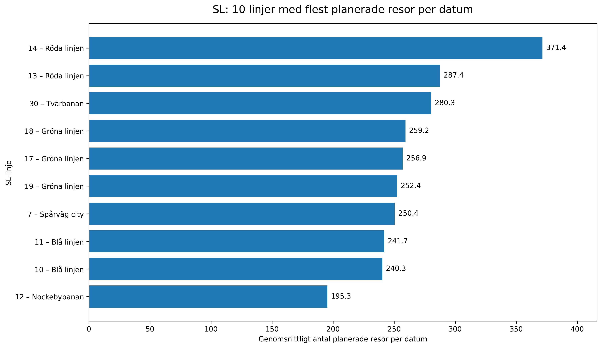

# Stockholm Public Transport Analysis

## Project Overview
This project explores Stockholm's public transport timetables using Python, pandas, and GTFS (General Transit Feed Specification) data.

The goal is to analyze scheduled departures, compare weekday and weekend service patterns, and identify routes with a high number of scheduled trips.

## Tools & Technologies
- Python
- pandas
- Google Colab
- GTFS static timetable data
- Matplotlib

## Key Questions
- How do scheduled departures vary by hour of the day?
- How do weekday and weekend timetable patterns differ?
- Which SL routes have the highest average number of scheduled trips per date?

## Key Findings
- Weekday departures peak around 07:00, with another peak around 16:00.
- Weekend departures are more evenly distributed throughout the day, with the highest average around 14:00.
- Metro route 14 (Red Line) has the highest average number of scheduled trips per date among the analyzed SL routes.
- Some trips in the dataset do not have associated stop-time records. These are documented as a data-quality limitation.

## Data Source
GTFS Sweden 3 static timetable data from Trafiklab, published by Samtrafiken i Sverige AB.

The analysis uses scheduled timetable data, not real-time delays, passenger counts, or confirmation that trips actually operated.

## Visualizations

### Average Scheduled Trips by SL Route

## Project Structure
- `images/` — Visualizations created during the analysis.
- `.ipynb` — Jupyter Notebook containing the Python analysis.

## Limitations
The analysis is based on the timetable data available in the downloaded GTFS feed. Scheduled departures should not be interpreted as passenger demand or actual service performance.
